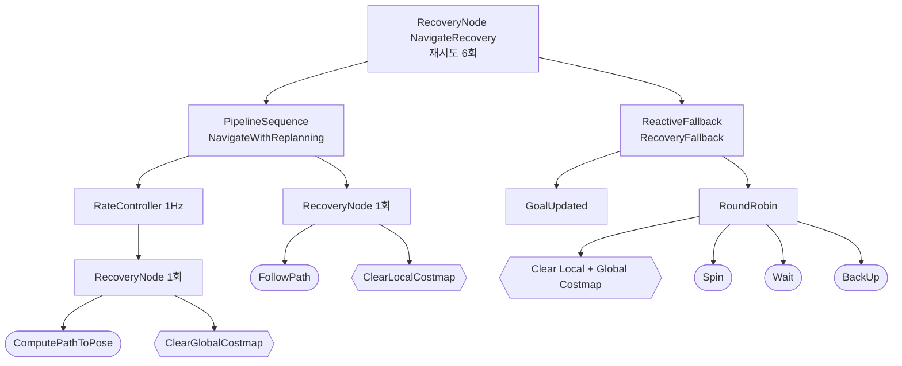

## 기본 NavigateToPose BT

`navigate_to_pose_w_replanning_and_recovery.xml`을 단순화한 것. Selector 노드(planner·controller·checker 선택)는 생략.

사각형은 제어 노드, 둥근 상자는 액션 호출, 육각형은 서비스 호출.

1) 본선은 1Hz로 `ComputePathToPose`를 다시 부르고 `FollowPath`로 따라간다. `PipelineSequence`라서 한 틱에 함께 돈다.
2) 각 액션이 실패하면 먼저 자기 코스트맵만 비우고 한 번 재시도한다. 플래너는 전역, 컨트롤러는 지역 코스트맵.
3) 그래도 실패하면 `RecoveryFallback`으로 넘어간다. 목표가 바뀌었으면(`GoalUpdated`) 리커버리 없이 새 목표로 간다.
4) 아니면 `RoundRobin`이 실패 때마다 클리어 → 회전 → 대기 → 후진 중 다음 하나를 시도하고 본선으로 돌아간다.
5) 6번 재시도해도 안 되면 목표 실패.

실제 트리에는 `WouldAPlannerRecoveryHelp`·`WouldAControllerRecoveryHelp` 조건이 붙어, 에러 코드상 리커버리가 소용없는 실패면 리커버리를 건너뛴다. Kilted부터 `RoundRobin`의 `wrap_around` 기본값이 `false`라 각 리커버리 동작은 한 번씩만 실행된다.
## 액션

BT의 각 리프가 액션 클라이언트이고, 서버가 실제 일을 한다.

| 서버 | 액션 | 하는 일 |
|---|---|---|
| BT Navigator | `NavigateToPose` | 목표 하나로 주행 (진입점) |
| BT Navigator | `NavigateThroughPoses` | 경유점을 거쳐 주행 |
| Planner Server | `ComputePathToPose` | 전역 경로 계산 |
| Planner Server | `ComputePathThroughPoses` | 경유점을 지나는 경로 계산 |
| Controller Server | `FollowPath` | 경로 추종, 속도 명령 생성 |
| Smoother Server | `SmoothPath` | 경로 평활화 |
| Behavior Server | `Spin` · `BackUp` · `DriveOnHeading` · `Wait` · `AssistedTeleop` | 리커버리·보조 동작 |
| Waypoint Follower | `FollowWaypoints` | 웨이포인트 순회 |

## 서비스

| 대상 | 서비스 | 하는 일 |
|---|---|---|
| Lifecycle Manager | `manage_nodes` | 서버 일괄 startup·pause·reset |
| Lifecycle Manager | `is_active` | 전체 활성 여부 조회 |
| 각 Lifecycle 노드 | `change_state` · `get_state` | 노드별 상태 전이·조회 |
| Costmap | `clear_entirely_*_costmap` · `clear_except_*` · `clear_around_*` | 코스트맵 비우기 |
| Costmap | `get_costs` | 좌표의 비용 조회 |
| Map Server | `load_map` · `map` | 지도 로드·조회 |
| AMCL | `global_localization` · `request_nomotion_update` | 전역 재위치추정·갱신 요청 |

코스트맵 클리어는 액션이 아니라 **서비스**다. BT의 `ClearEntireCostmap` 노드가 `local_costmap/clear_entirely_local_costmap` 같은 서비스를 부른다.

## 토픽

| 방향 | 토픽 | 비고 |
|---|---|---|
| 입력 | `/scan` (또는 depth·PointCloud) | Costmap 장애물 층이 구독 |
| 입력 | `/odom` · `/tf` · `/tf_static` | 로봇 상태·좌표 변환 |
| 입력 | `/map` | transient local, Map Server가 발행 |
| 입력 | `/initialpose` | AMCL 초기 위치 |
| 입력 | `/goal_pose` | RViz 버튼 → BT Navigator가 `NavigateToPose`로 변환 |
| 내부 출력 | `/plan` · `/local_plan` | 전역·지역 경로 |
| 내부 출력 | `/global_costmap/costmap` · `/local_costmap/costmap` | 비용 지도 |
| 내부 출력 | `/amcl_pose` | 추정 위치 |
| 최종 출력 | `/cmd_vel` | 바퀴 명령 |

## cmd_vel 체인

`/cmd_vel_nav` (Controller Server) → `/cmd_vel_smoothed` (Velocity Smoother) → `/cmd_vel` (Collision Monitor) → 로봇 베이스.

Collision Monitor를 안 쓰면 Velocity Smoother가 `cmd_vel_smoothed`를 `cmd_vel`로 바로 remap한다. 이름은 launch·YAML에 따라 다르다.

Lyrical에서는 타입이 `TwistStamped`다(`enable_stamped_cmd_vel`). 로봇이 안 움직이면 `ros2 topic info /cmd_vel -v`로 발행자·구독자의 타입 일치부터 본다.

## Costmap의 위치

Costmap은 별도 서버가 아니라 Planner·Controller 서버 안의 컴포넌트다. 센서 토픽을 구독하고 costmap 토픽을 발행한다.

---

출처: https://docs.nav2.org/behavior_trees/trees/nav_to_pose_recovery.html (rolling 문서 기준, Lyrical 설치본 미대조)

> **QUESTION**
> 40강에서 Nav2 구조도를 보다가, 그림 속 연결선 중 무엇이 토픽·액션·서비스인지 구분되지 않아서.
